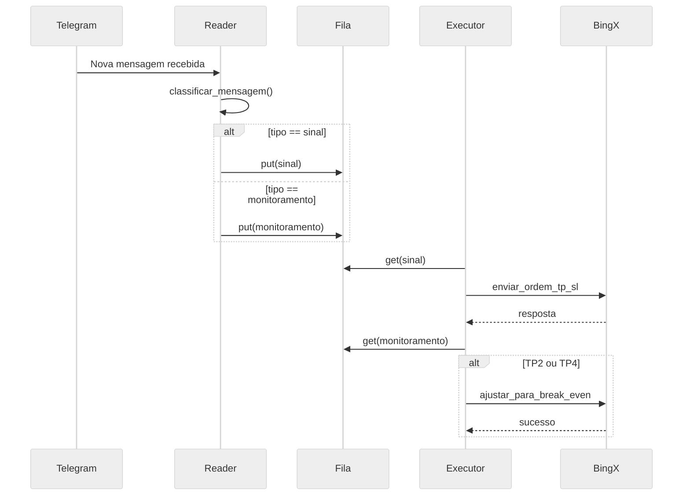

# 📄 README.md — Projeto Telegram Crypto Signal Bot

## 📚 Descrição

Este projeto é dividido em **dois serviços independentes**:

* **TelegramReader**: Monitora mensagens de sinais de trading em grupos ou canais do Telegram e deposita em uma fila.
* **TradeExecutorSinal**: Recupera mensagem da fila de sinais, identifica sinais pendentes e envia ordens automáticas para a BingX.
* **TradeExecutorTP**: Recupera mensagem da fila de tp, identifica sinais pendentes e envia ordens automáticas para a BingX.

✅ Arquitetura desacoplada, modular e escalável.
✅ Configuração fácil para ambiente de testes e produção.

---

## 🛠️ Estrutura do Projeto

```
TelegramReader/
├── .venv/
├── docs/
├── fila/
├── integration/
│   ├── __init__.py
│   ├── BingXBroker.py
│   └── BrokerInterface.py
├── log/
│   ├── __init__.py
│   └── logger_config.py
├── logs/
│   └── app.log
├── message/
│   ├── mensagem_sinal.py
│   └── mensagem_tp.py
├── .env
├── .gitignore
├── config.properties
├── estrutura.txt
├── minha_sessao.session
├── README.md
├── requirements.txt
├── start_all.py
├── start_bot.bat
├── start_bot.sh
├── TelegramReader.py
├── TradeExecutorSinal.py
├── TradeExecutorTP.py
└── utils.py
```

---

## 📦 Instalação

1. Clone ou copie este projeto para sua máquina.

2. Crie o ambiente virtual Python:

```bash
python -m venv venv
```

3. Ative o ambiente virtual:

- **Windows**:

```bash
venv\Scripts\activate
```

- **Linux/macOS**:

```bash
source venv/bin/activate
```

4. Instale as dependências:

```bash
pip install -r requirements.txt
```

---

## ⚙️ Configuração

Edite o arquivo `config.properties`:

```ini
# Telegram API
api_id=API ID
api_hash=API HASH
group_id=ID DO GRUPO QUE SE DESEJA MONITORAR MENSAGENS
session_name=NOME DO ARQUIVO DE SESSÃO CRIADO AO LOGAR NO TELEGRAM

#BingX API
bingx_apy_key=BING X API KEY
bingx_secret_key=BING X SECRET

bingx_api_url_testnet=https://open-api-vst.bingx.com
bingx_api_url=#https://open-api.bingx.com

# Trading Strategy
trade_percentage=3

```

---

## 🏁 Primeiro Uso

1. Inicie o sistema (duas formas):

### Forma 1: Script start_all.py

```bash
python start_all.py --testnet  # Recomendado para executar todos os componentes
```

### Forma 2: Clique duplo no `start_bot.bat` (Windows)

> Crie um arquivo `start_bot.bat` com o seguinte conteúdo:

```bat
@echo off
cd /d %~dp0
python start_all.py --testnet
pause
```
### Forma 2: Executar `start_bot.sh` (Linux Alpine)

> Crie um arquivo `start_bot.sh` com o seguinte conteúdo:
> 
```shell
#!/bin/sh
cd /root/TelegramReader
. venv/bin/activate
python3 start_all.py --mainnet >> /var/log/tradebot.log 2>&1
```
> Dê Permissão de execução
```shell
chmod +x /root/TelegramReader/start_bot.sh
```

### Crie um script para inicialização automática
> Crie um arquivo `/etc/init.d/tradebot` com o seguinte conteúdo:
```
#!/sbin/openrc-run

name="tradebot"
description="Bot de sinais para BingX executando no TelegramReader"

command="/root/TelegramReader/start_bot.sh"
command_background=true
pidfile="/run/tradebot.pid"

depend() {
    need net
}
```
#### Configure o serviço
```
rc-update add tradebot default
```

#### Comandos disponíveis
```
rc-service tradebot start
rc-service tradebot stop
rc-service tradebot restart
rc-service tradebot status
```

#### Acompanhar log
```
tail -f /var/log/tradebot.log
```
---

## 🔐 Segurança das Credenciais

O arquivo `.env` é gerado automaticamente e contém suas chaves da API da BingX.
**Recomenda-se adicioná-lo ao `.gitignore`** para evitar exposição em repositórios públicos.

---

## 📋 Logs

- Log da aplicação: `/var/log/tradebot.log`

---

## 🧠 Observações

* Projeto utiliza **fila persistente** com `persistqueue`, permitindo reinício seguro mesmo após falhas.
* Threads separadas para leitura do Telegram, envio de ordens e configuração de TP/SL.
* Pode rodar como serviço em ambientes Linux.
* Suporte a múltiplos Take Profits com proporções configuráveis.

---

## 📊 Resumo Técnico - Projeto Telegram Trade Bot (BingX Testnet)

Este projeto integra sinais de trade recebidos via Telegram com execução automática de ordens na corretora BingX podendo ser configurado para a rede de teste ou produção.

### ✅ Funcionalidades Implementadas

#### TelegramReader

* Escuta mensagens em grupos do Telegram.
* Classifica mensagens como sinais de entrada ou monitoramento.
* Armazena sinais estruturados com múltiplos TP em filas persistentes.

#### TradeExecutorSinal

* Consome sinais da fila `sinais`.
* Calcula saldo, margem, alavancagem, e quantidade proporcional.
* Envia ordem para BingX e configura múltiplos Take Profits (TPs).
* Atualiza banco com ordem enviada e configurações feitas.
* Registra `proporcao` de cada TP no banco para análise futura e possível reentrada.

#### TradeExecutorTP

* Consome sinais da fila `monitoramentos`.
* Identifica atingimento de TP2 ou TP4.
* Realiza operação de Break Even ajustando SL via BingX.
* Marca no banco como break even executado.

#### Fila Persistente

* Utiliza `persistqueue.SQLiteQueue` para garantir robustez.
* Resistente a falhas de energia ou reinicializações inesperadas.

---

## 🔍 Documentação dos Arquivos-Chave

* `TelegramReader.py`: Leitor principal de mensagens do Telegram.
* `TradeExecutorSinal.py`: Envia ordens e configura TPs.
* `TradeExecutorTP.py`: Monitora e executa Break Even.
* `BingXBroker.py`: Wrapper da API BingX.
* `utils.py`: Helpers de arredondamento, configuração e parser.
* `mensagem_sinal.py`: Modelo e validação de mensagens de trade.

---

## 📈 Diagrama de Sequência



---

## 📚 Sequência de Chamadas Explicada

### 📥 TelegramReader

1. Escuta mensagens usando `Telethon`.
2. `classificar_mensagem()` determina se é sinal ou monitoramento.
3. Armazena a mensagem na fila apropriada (`sinais` ou `monitoramentos`).

### ⚙️ TradeExecutorSinal

1. Consome sinais da fila `sinais`.
2. Valida e transforma a mensagem via `MensagemSinal`.
3. Calcula quantidade com base em saldo e `trade_percentage`.
4. Envia ordem com múltiplos TPs usando proporções \[0.1, 0.2, 0.5, 0.2].

### 📈 TradeExecutorTP

1. Consome mensagens de `monitoramentos`.
2. Se for TP2 ou TP4:

   * Busca ordem ativa relacionada.
   * Cancela SL atual e envia novo SL para preço de entrada (Break Even).

---

## 📖 Geração de documentação

> Navegue até a pasta docs
- **Linux**
```shell
make html
```
- **Windows**:
```bash
make.bat html
```
---