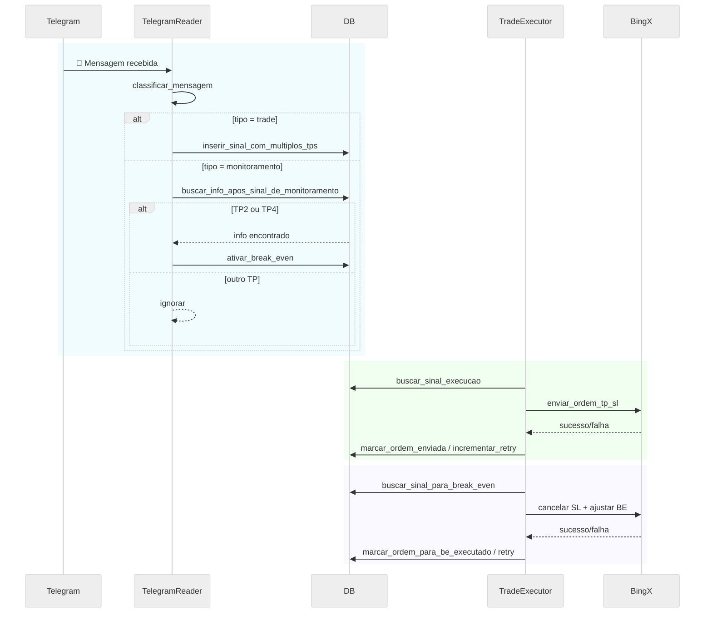

# 📄 README.md — Projeto Telegram Crypto Signal Bot

## 📚 Descrição

Este projeto é dividido em **dois serviços independentes**:

- **TelegramSignalReader**: Monitora mensagens de sinais de trading em grupos ou canais do Telegram e grava em um banco de dados.
- **TradeExecutor**: Monitora o banco de dados, identifica sinais pendentes e envia ordens automáticas para a ByBIT Testnet.

✅ Arquitetura desacoplada, modular e escalável.  
✅ Configuração fácil para ambiente de testes e produção.  
✅ Pronto para migrar de SQLite para PostgreSQL.

---

## 🛠️ Estrutura do Projeto

```
ProjetoTelegramTradeBot/
├── database/
│   ├── criar_tabela.py
│   └── upgrade_database.py
├── integration/
│   ├── BingXBroker.py
│   └── BrokerInterface.py
├── log/
│   └── log_config.py
├── logs/
├── venv/
├── web_dashboard/
│   ├── templates/
│   │   ├── apdashboardp.html
│   └── app.py
├── .env
├── .gitignore
├── config.properties
├── docker-compose.yml
├── minha_sessao.session
├── README.md
├── requirements.txt
├── start_all.py
├── TelegramReader.py
├── TradeExecutor.py
└── utils.py
```

---

## 📦 Instalação

1. Clone ou copie este projeto para sua máquina.

2. Crie o ambiente virtual Python:

```bash
python -m venv venv
```

3. Ative o ambiente virtual:

- **Windows**:

```bash
venv\Scripts\activate
```

- **Linux/macOS**:

```bash
source venv/bin/activate
```

4. Instale as dependências:

```bash
pip install -r requirements.txt
```

---

## ⚙️ Configuração

Edite o arquivo `config.properties`:

```ini
# Telegram Config
api_id=SEU_API_ID_DO_TELEGRAM
api_hash=SEU_API_HASH_DO_TELEGRAM
grupo_id=ID_DO_GRUPO_OU_CANAL

# ByBIT Testnet Config
bybit_api_key=SUA_API_KEY
bybit_api_secret=SEU_API_SECRET

# Trading Strategy
trade_percentage=3  # Percentual do saldo disponível para usar em cada trade

# Database Config (modo atual: SQLite)
database_mode=sqlite
sqlite_db_path=database/sinais.db


database_mode=postgresql
postgres_host=localhost
postgres_port=5432
postgres_user=usuario
postgres_password=senha
postgres_db=sinais
```

---

## 🏁 Primeiro Uso

1. Crie o banco de dados:

```bash
python database/criar_tabela.py
```

2. Inicie o sistema (duas formas):

### Forma 1: Script start_all.py

```bash
python start_all.py --testnet
```

### Forma 2: Clique duplo no `start_bot.bat` (Windows)

> Crie um arquivo `start_bot.bat` com o seguinte conteúdo:

```bat
@echo off
cd /d %~dp0
python start_all.py --testnet
pause
```

---

## 📦 Rodar com Docker

Se preferir rodar tudo isolado em containers:

1. Crie um `docker-compose.yml` com o seguinte conteúdo:

```yaml
version: '3'
services:
  telegram_bot:
    build: .
    container_name: telegram_signal_reader
    command: python TelegramSignalReader.py
    volumes:
      - .:/app
    restart: unless-stopped

  trade_executor:
    build: .
    container_name: trade_executor
    command: python TradeExecutor.py
    volumes:
      - .:/app
    restart: unless-stopped
```

2. Rode:

```bash
docker-compose up -d
```

---

## 📋 Logs

- Log da aplicação: `logs/app.log`

---

## 🧠 Observações

- Este projeto usa **ByBIT Testnet** — perfeito para treinar sem risco financeiro.
- Posteriormente, será possível migrar para **produção real** na ByBIT com poucas alterações no endpoint e nas chaves.
- O projeto já está preparado para usar **PostgreSQL**

---

## 📈 Melhorias Futuras

- dividir em 5 ordens [0.1, 0.2, 0.5, 0.1, 0.1]
- Adicionar suporte a stop móvel (trailing stop) para o último lote de 10% de forma manual, por isso eu coloco o stop loss automático em break even para assim dar tempo de manualmente criar o stop loss sem medo de perder dinheiro 
- Interface web para monitorar sinais em tempo real.

---

# 🚀 Bora automatizar!
---

## 🌐 Rodar o Painel Web

O Painel Web permite visualizar em tempo real:

- Sinais captados
- Status de execução
- Ordens pendentes ou executadas

### Como rodar o painel:

1. Instale o Flask, se ainda não tiver:

```bash
pip install flask
```

2. Vá até a pasta do painel:

```bash
cd web_dashboard
```

3. Inicie o servidor:

```bash
python app.py
```

4. Acesse no navegador:

> http://localhost:5000/

O painel mostrará os sinais captados e seu status!

---

TODO

To use Demo Trading API, you need to:
1) switch over to Demo on Mainnet (bybit.com)
2) head over to https://www.bybit.com/app/user/api-management
3) create an API key while in Demo Trading mode

You can now use this API for Demo Trading. Assuming you use pybit, it's done by setting testnet=False and demo=True

5. Resumo Técnico
# 📊 Resumo Técnico - Projeto Telegram Trade Bot (Bybit Testnet)

Este projeto integra sinais de trade recebidos via Telegram com execução automática de ordens na corretora Bybit, utilizando a API v5 e operando inicialmente na **testnet**. 

## ✅ Funcionalidades Implementadas

### 1. Leitura de Sinais do Telegram
- Monitoramento de mensagens com sinais de trade (entrada, TPs e SL).
- Extração dos dados relevantes (par, tipo, entrada, take profits, stop loss).
- Armazenamento estruturado no banco e em JSON.

### 2. Controle de Configuração
- Arquivo `config.properties` centraliza todas as chaves da Bybit, BingX, e parâmetros de trade.
- Geração automática do arquivo `.env` com base nas escolhas feitas ao iniciar o bot.
- Suporte a testnet e mainnet.

### 3. Logs e Erros
- Logs detalhados das chamadas à API.
- Tratamento de erros de envio de ordens e TP.

## Diagrama de Sequência



## Diagrama UML


## 📚 Sequência de Chamadas Explicada

### 📥 Parte 1: Recebimento e Processamento da Mensagem (TelegramReader)

1. **Mensagem recebida do Telegram**  
   O `TelegramReader` escuta mensagens no grupo configurado via Telethon.

2. **`classificar_mensagem(mensagem)`**  
   Determina se a mensagem recebida é:
   - um **sinal de trade** (entrada nova), ou
   - uma **mensagem de monitoramento** (ex: TARGET #2 DONE ou #4 DONE).

3. **Se for sinal de trade → `inserir_sinal_com_multiplos_tps(dados)`**  
   - Extrai os TPs (`tp1` a `tp4`) e o SL.
   - Divide o trade em 5 ordens com proporções: 10%, 20%, 50%, 10%, 10%.
   - Insere cada ordem na tabela `sinais`. A última não possui TP.

4. **Se for mensagem de monitoramento:**
   - Se for **TP2 ou TP4**:
     - `buscar_info_apos_sinal_de_monitoramento(par)`  
     - Se encontrar ordem, chama `ativar_break_even(id)` para sinalizar que o SL pode ser movido.
   - Outros TPs são atualmente ignorados.


### 🧠 Parte 2: Executor (TradeExecutor)

5. **Loop contínuo → `buscar_sinal_execucao()`**  
   - Busca ordens com `ordem_status_id = 0` e `tentativas < 3`.

6. **Para cada sinal encontrado:**
   - Obtém saldo → `broker.obter_saldo_disponivel()`
   - Obtém preço de mercado → `broker.obter_preco_mercado(symbol)`
   - Calcula a quantidade com base na proporção (ex: 0.2 para 20%).
   - Envia ordem de entrada com SL e TP → `broker.enviar_ordem_tp_sl(...)`
   - Se sucesso:
     - `marcar_ordem_enviada(...)`
   - Se falha:
     - `incrementar_retry_order(...)` ou `desabilitar_sinal(...)` se erro de símbolo.


### 🔁 Parte 3: Monitoramento de Break Even

7. **Se não há sinais novos, busca → `buscar_sinal_para_break_even()`**
   - Encontra sinais que já atingiram TP2 ou TP4 e estão prontos para mover o SL.

8. **Executa ajuste de SL para preço de entrada:**
   - Chama `broker.ajustar_para_break_even(...)` (cancela SL antigo e envia novo SL)
   - Se sucesso → `marcar_ordem_para_be_executado(par)`
   - Se falha → `incrementar_retry_be(id)`

