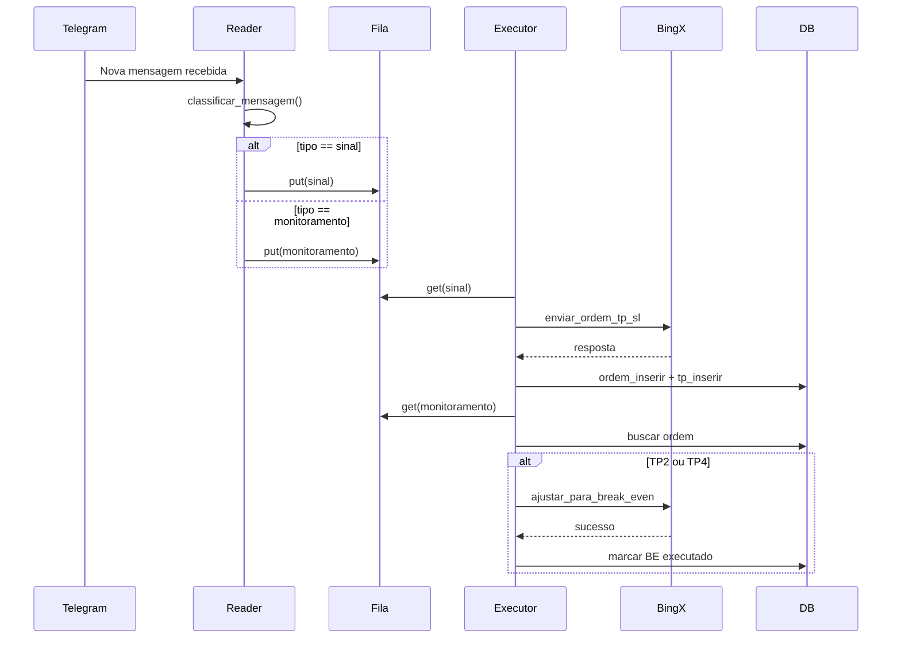

# 📄 README.md — Projeto Telegram Crypto Signal Bot

## 📚 Descrição

Este projeto é dividido em **dois serviços independentes**:

* **TelegramSignalReader**: Monitora mensagens de sinais de trading em grupos ou canais do Telegram e grava em um banco de dados.
* **TradeExecutor**: Monitora o banco de dados, identifica sinais pendentes e envia ordens automáticas para a BingX Testnet.

✅ Arquitetura desacoplada, modular e escalável.
✅ Configuração fácil para ambiente de testes e produção.
✅ Pronto para migrar de SQLite para PostgreSQL.

---

## 🛠️ Estrutura do Projeto

```
TelegramReader/
├── .venv/
├── database/
│   ├── scripts/
│   │   ├── break_even_status.sql
│   │   ├── inser_break_even_status.sql
│   │   ├── inser_ordem_status.sql
│   │   ├── inser_take_profit_status.sql
│   │   ├── ordem_status.sql
│   │   ├── sinais.sql
│   │   ├── take_profit_status.sql
│   │   └── take_profits.sql
│   ├── __init__.py
│   ├── criar_tabela.py
│   ├── db.py
│   ├── sinal.py
│   ├── stop_loss.py
│   └── take_profit.py
├── docs/
├── fila/
├── integration/
│   ├── __init__.py
│   ├── BingXBroker.py
│   └── BrokerInterface.py
├── log/
│   ├── __init__.py
│   └── logger_config.py
├── logs/
│   └── app.log
├── message/
│   ├── mensagem_sinal.py
│   └── mensagem_tp.py
├── .env
├── .gitignore
├── config.properties
├── estrutura.txt
├── minha_sessao.session
├── README.md
├── requirements.txt
├── start_all.py
├── start_bot.bat
├── start_bot.sh
├── TelegramReader.py
├── TradeExecutorSinal.py
├── TradeExecutorTP.py
└── utils.py
```

---

## 📦 Instalação

\[sem mudanças]

---

## ⚙️ Configuração

\[sem mudanças]

---

## 🏁 Primeiro Uso

\[sem mudanças]

---

## 📋 Logs

\[sem mudanças]

---

## 🧠 Observações

* Projeto utiliza **fila persistente** com `persistqueue`, permitindo reinício seguro mesmo após falhas.
* Threads separadas para leitura do Telegram, envio de ordens e configuração de TP/SL.
* Pode rodar como serviço em ambientes Linux.
* Suporte a múltiplos Take Profits com proporções configuráveis.

---

## 📊 Resumo Técnico - Projeto Telegram Trade Bot (BingX Testnet)

Este projeto integra sinais de trade recebidos via Telegram com execução automática de ordens na corretora BingX podendo ser configurado para a rede de teste ou produção.

### ✅ Funcionalidades Implementadas

#### TelegramReader

* Escuta mensagens em grupos do Telegram.
* Classifica mensagens como sinais de entrada ou monitoramento.
* Armazena sinais estruturados com múltiplos TP em filas persistentes.

#### TradeExecutorSinal

* Consome sinais da fila `sinais`.
* Calcula saldo, margem, alavancagem, e quantidade proporcional.
* Envia ordem para BingX e configura múltiplos Take Profits (TPs).
* Atualiza banco com ordem enviada e configurações feitas.

#### TradeExecutorTP

* Consome sinais da fila `monitoramentos`.
* Identifica atingimento de TP2 ou TP4.
* Realiza operação de Break Even ajustando SL via BingX.
* Marca no banco como break even executado.

#### Fila Persistente

* Utiliza `persistqueue.SQLiteQueue` para garantir robustez.
* Resistente a falhas de energia ou reinicializações inesperadas.

---

## 🔍 Documentação dos Arquivos-Chave

* `TelegramReader.py`: Leitor principal de mensagens do Telegram.
* `TradeExecutorSinal.py`: Envia ordens e configura TPs.
* `TradeExecutorTP.py`: Monitora e executa Break Even.
* `BingXBroker.py`: Wrapper da API BingX.
* `db.py`: Funções auxiliares de acesso ao banco.
* `utils.py`: Helpers de arredondamento, configuração e parser.
* `mensagem_sinal.py`: Modelo e validação de mensagens de trade.

---

## 📈 Diagrama de Sequência



---

## 📚 Sequência de Chamadas Explicada

### 📥 TelegramReader

1. Escuta mensagens usando `Telethon`.
2. `classificar_mensagem()` determina se é sinal ou monitoramento.
3. Armazena a mensagem na fila apropriada (`sinais` ou `monitoramentos`).

### ⚙️ TradeExecutorSinal

1. Consome sinais da fila `sinais`.
2. Valida e transforma a mensagem via `MensagemSinal`.
3. Calcula quantidade com base em saldo e `trade_percentage`.
4. Envia ordem com múltiplos TPs usando proporções \[0.1, 0.2, 0.5, 0.2].
5. Atualiza banco com `ordem_inserir` e `tp_inserir`.

### 📈 TradeExecutorTP

1. Consome mensagens de `monitoramentos`.
2. Se for TP2 ou TP4:

   * Busca ordem ativa relacionada.
   * Cancela SL atual e envia novo SL para preço de entrada (Break Even).
   * Atualiza banco com status de Break Even aplicado.

---

## 📖 Geração de documentação

\[sem mudanças]

---

## 🧾 Dicionário de Dados

### Tabela `sinais`

| Campo                   | Tipo      | Descrição                   |
| ----------------------- | --------- | --------------------------- |
| id                      | serial    | Identificador único         |
| data\_hora              | timestamp | Momento do sinal            |
| par                     | text      | Par de negociação           |
| tipo\_ordem             | text      | BUY ou SELL                 |
| margem                  | text      | Tipo de margem (ex: CROSS)  |
| alavancagem             | text      | Alavancagem usada (ex: 20X) |
| sl                      | real      | Valor do Stop Loss          |
| quantidade              | real      | Quantidade da ordem         |
| break\_even\_status\_id | smallint  | Controle de BE              |
| ordem\_status\_id       | smallint  | Status da ordem             |
| order\_id               | bigint    | ID externo da corretora     |
| entry\_price            | real      | Preço de execução           |
| janela\_5min            | timestamp | Janela anti-duplicação      |

### Tabela `take_profits`

| Campo          | Tipo     | Descrição            |
| -------------- | -------- | -------------------- |
| sinal\_id      | integer  | FK para `sinais`     |
| numero         | smallint | TP1 a TP4            |
| valor          | real     | Preço alvo           |
| quantidade     | real     | Quantidade associada |
| tp\_status\_id | smallint | Status do TP         |
| proporcao      | real     | Proporção da ordem   |

### Tabela `ordem_status`

| ID | Descrição    |
| -- | ------------ |
| 0  | RECEBIDA     |
| 1  | ENVIADA      |
| 2  | DESABILITADA |
| 3  | CONCLUÍDA    |

### Tabela `break_even_status`

| ID | Descrição |
| -- | --------- |
| 0  | INATIVO   |
| 1  | ATIVAR    |

### Tabela `take_profit_status`

| ID | Descrição   |
| -- | ----------- |
| 1  | PENDENTE    |
| 2  | CONFIGURADO |
| 3  | ATINGIDO    |
